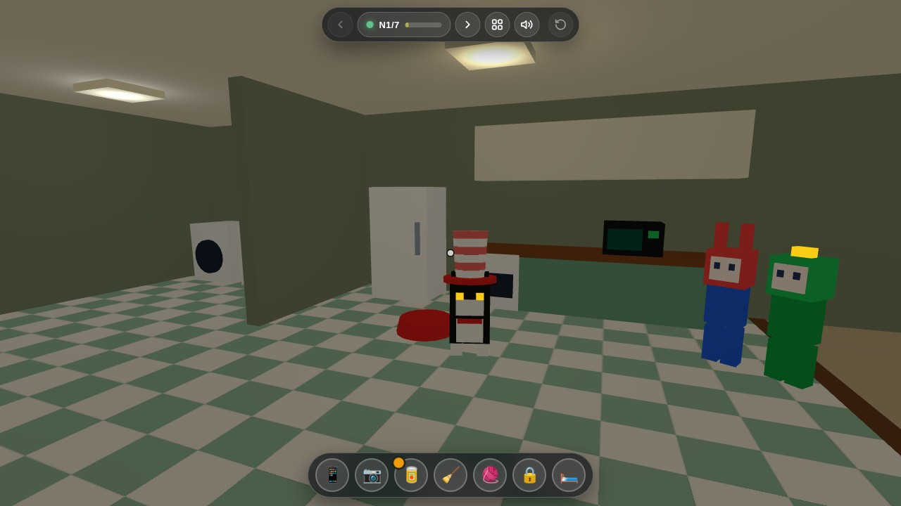

# 7 Days Cat-Sitting 3D (Roblox Remake)

Interactive Three.js 3D suburban house cat-sitting & cat-rules survival game faithfully reproducing [**WE IGNORED the CAT RULES IN 7 DAYS CAT-SITTING in roblox!**](https://youtu.be/VSQXM4IS8VE) by *RABBITTURTLE Blox*.

**Live Game**: https://kunruiw1991.github.io/roblox-7days-cat-sitting/

## Highlights
- **6 Seamless 3D Retro Suburban House Rooms**: Green-and-white checkered Kitchen (mint cabinets, opening white fridge, microwave, stove, red cat bowl), Laundry Room (twin front-loading washers & interactive Litter Box), Living Room (dark-green sofa, string cat toy, glowing cyan TV, red curtains & Shadow Window Stalker), Hallway & Front Door Lock, Nighttime Front Yard & Green Mailbox, and Master Bedroom (blue bed + red-checkered bathroom).
- **Iconic Tuxedo Cat in Red-and-White Striped Top Hat & Bowtie** + Rabbit & Turtle buddies.
- **All 7 Nights + Smartphone Rules & Camera + Litter Box Scoop Mini-Game**.
- **All 6 Authentic Roblox Fail Endings (Ignore the Cat Rules!)**: `Cold as Ice`, `Blackhole`, `Evicted`, `Uh oh Stinky`, `Ancy`, and `Fired` — plus instant `REVIVE` and Night 7 Victory!
- **Streamlined Wordless Floating-Pill UI**: Instant-play on load, frosted floating top & bottom icon pills, 3-tab gallery (`🌙 7 Nights`, `🏠 6 Rooms`, `💀 6 Endings`), centered dimmed-backdrop destructive reset modal, and procedural Web Audio SFX.

## Verification & Cross-Model QA
- Unit Tests: `node --test --experimental-test-coverage tests/unit.test.js`
- Multi-Viewport WebGL Playwright E2E + Comparison Grid: `python3 tests/e2e_verify.py`
- Side-by-side visual audit grid: [`.qa/comparison_grid.png`](.qa/comparison_grid.png)
- External Auditors configured for **Claude Opus 5.5 (`extra`)** and **Codex GPT Astra (`medium`)** via GitHub PR (`@claude` + `@codex review`).
